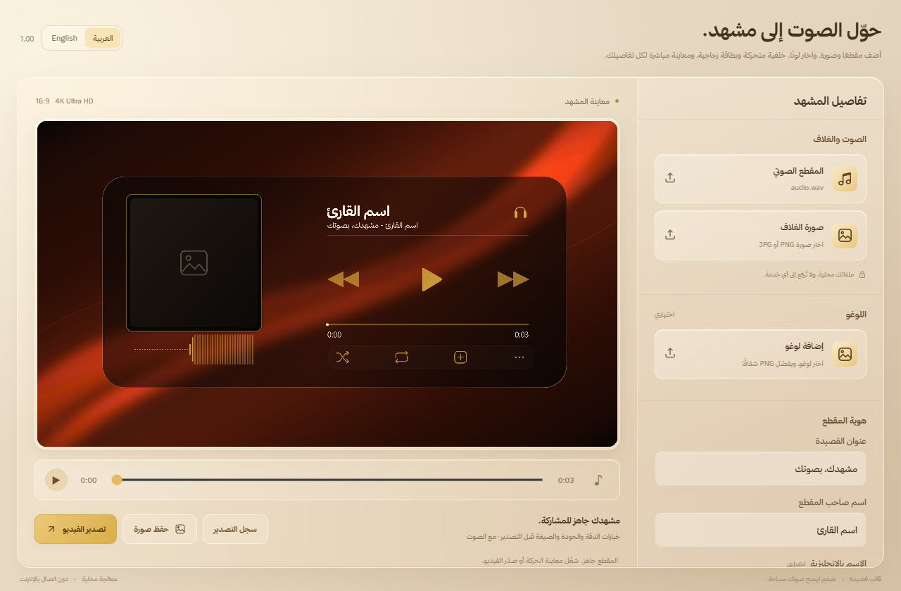

# Qaseeda Template · قالب قصيدة · 1.00

[English](README.md) · **العربية**

برنامج محلي لتحويل المقطع الصوتي وصورة الغلاف إلى فيديو ببطاقة زجاجية وموجة صوتية حقيقية. يدعم خلفية من أي صورة يختارها المستخدم مع حركة إضاءة تلقائية، دون رفع الملفات إلى خادم.



<details>
<summary><b>معاينة الواجهة بالإنجليزية (English interface)</b></summary>


</details>

## اللغة

يمكنك التبديل بين العربية والإنجليزية من أعلى النافذة. يحفظ البرنامج اللغة المختارة ويضبط اتجاه الواجهة تلقائيًا، دون تغيير أسماء الملفات أو النصوص التي تكتبها. الإصدار الظاهر للمستخدم هو **1.00**.

## المميزات

- رفع صوت وصورة غلاف ولوغو اختياري، دون مقطع تجريبي محمّل مسبقًا.
- تجهيز الصور الكبيرة في عامل خلفي للحفاظ على استجابة الواجهة أثناء الرفع.
- رفع صورة مستقلة للخلفية مع حركة إضاءة، والاحتفاظ بألوانها الأصلية أو تلوينها بلون المشهد.
- قصّ مركزي بنسبة 16:9 دون تشويه الصورة، مع معالجة حتى 3840×2160 بحسب دقة المصدر.
- موجة مبنية على الصوت الحقيقي، وقت متقدم، وخيارات دخول وخروج.
- خطوط عربية وإنجليزية، ألوان مخصصة وأداة التقاط لون.
- تصدير MP4 أو WebM، دقات حتى 4K، ومعدل إطارات وبيانات مخصص.
- نسخة Windows مع Direct3D11/NVENC عند توفر بطاقة NVIDIA متوافقة، ومسار FFmpeg بديل؛ سجل تصدير وتنبيه عند الاكتمال.

الحركة المطبقة على الصور هي حركة إضاءة فوق الصورة؛ لا يعيد البرنامج إنشاء فيديو حقيقي للأشياء الموجودة داخلها. الصور العمودية والمربعة تُقصّ أطرافها لتملأ المشهد. زيادة دقة التصدير لا تُضيف تفاصيل غير موجودة بالمصدر.

## الاستخدام

1. نزّل `QaseedaTemplate-1.00-Setup.exe` من GitHub Releases وشغّله. هذا مثبّت صغير ينزّل WebView2 من Microsoft عند الحاجة، وينزّل FFmpeg بعد التحقق من بصمته إذا أبقيت خياره محددًا. يلزم الاتصال بالإنترنت عند غياب هذه المتطلبات. أو افتح `Start.cmd` في Chrome أو Edge لمعاينة نسخة المتصفح.
2. إذا اخترت نسخة ZIP المحمولة، ثبّت FFmpeg بنفسك؛ ضعه بجوار التطبيق أو اختر `ffmpeg.exe` عند أول تصدير. يحفظ البرنامج مساره تلقائيًا. يمكنك أيضًا إلغاء خيار FFmpeg أثناء التثبيت واستخدام نسختك الخاصة.
3. أضف الصوت والغلاف، ثم اكتب عنوان المقطع والاسم.
4. ضمن «خلفية المشهد» اضغط «أضف خلفيتك» واختر صورة، ثم اضبط خيار «الحفاظ على ألوان الخلفية».
5. جرّب الحركة ثم اختر إعدادات التصدير.

تصدير Windows يعمل دون تشغيل الصوت أو انتظار مدة المقطع. التصدير من المتصفح يتوقف على دعم MediaRecorder وقد يستغرق مدة المقطع؛ افتح البرنامج في المقدمة أثناءه. دعم صيغ الصوت يتبع قدرات المتصفح/WebView2. الواجهة تعمل محليًا؛ لا يلزم حساب أو مفتاح API.

## التشغيل من المصدر

المتطلبات: Chrome/Edge حديث. افتح `Start.cmd` أو شغّل خادم ملفات محليًا:

```sh
python -m http.server 8765 --bind 127.0.0.1
```

ثم افتح `http://127.0.0.1:8765/`. لا توجد حزم JavaScript مطلوبة للتشغيل.

لفحص المصدر باستخدام Node.js 20.11 أو أحدث:

```sh
npm run check
```

## بناء Windows

تحتاج Windows 10/11 x64، وVisual Studio 2022 Build Tools مع أدوات C++ وWindows SDK، و.NET Framework 4.8. يُستعاد WebView2 SDK بإصدار وبصمة ثابتين. يوفّر المثبّت WebView2 Runtime وFFmpeg الاختياري للمستخدم.

```powershell
powershell -ExecutionPolicy Bypass -File desktop/Build.ps1 -ExternalFFmpeg
```

الناتج: `release/QaseedaTemplate.exe`. اقرأ [دليل البناء](docs/BUILD.md) و[دليل النشر](docs/PUBLISH.md).

## الترخيص والوسائط

الشيفرة الأصلية ورسوم المشروع والأيقونة مرخّصة وفق MIT. تراخيص المكونات الخارجية والخطوط منفصلة في [THIRD_PARTY_NOTICES.md](THIRD_PARTY_NOTICES.md).

حزمة GitHub النظيفة تستخدم خلفيات وحركة إضاءة مولدتين بالشيفرة بدل ملفات المرجع الخاصة، ولا تتضمن تسجيل القصيدة أو فيديو المرجع أو ملف خط ثمانية المضمّن. خط ثمانية يعمل إن كان مثبتًا محليًا؛ تتوفر أيضًا خطوط النظام. يستطيع كل مستخدم إضافة صوره وصوته من جهازه. ملفات المستخدم لا تحفظ في المستودع.

## English

Offline Arabic audio visualizer and Windows video exporter with a minimal glass UI. Upload audio, cover art, a logo and any background image; a moving light effect is applied automatically. Original image colors can be preserved. Supports true audio waveforms, timed typography, entrance/exit effects and custom export settings. Windows export uses Direct3D11/NVENC where available and FFmpeg fallback; browser recording depends on browser capabilities.

No runtime npm dependencies. Run `npm run check` for source checks; see [BUILD.md](docs/BUILD.md) for Windows builds. The public source package excludes private reference media and embedded proprietary fonts.
