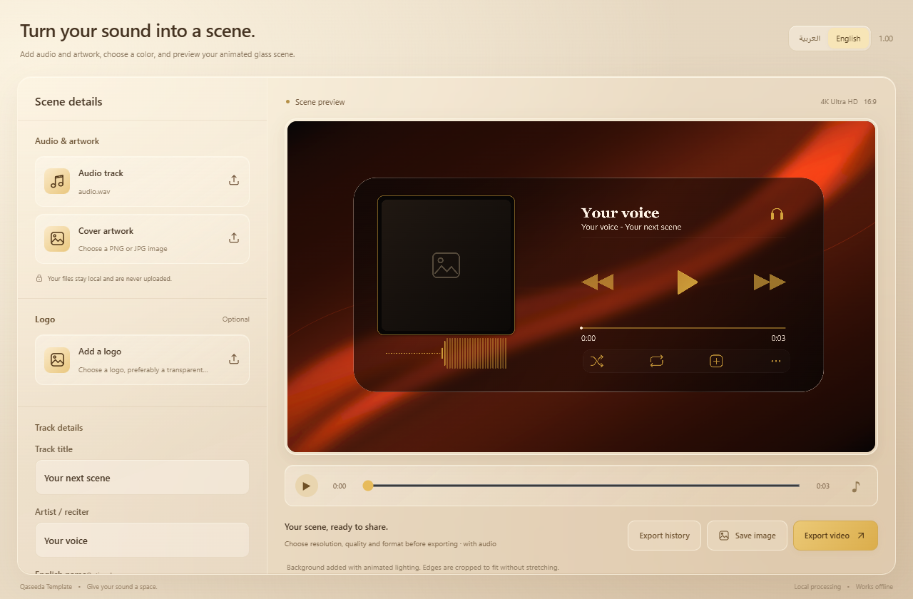

# Qaseeda Template · 1.01

**English** · [العربية](README.ar.md)

An offline audio visualizer and Windows video creator with a minimal glass interface. Upload an audio track, cover artwork, an optional logo and your own background image. Animated lighting is applied to the background automatically.



## Features

- Switch between **English** and **العربية** at the top of the window. Your choice is saved; text direction changes automatically. Uploaded filenames, track titles and artist names are never translated.
- Starts without a demo recording or personal artwork.
- Supports custom backgrounds, preserved source colors or a scene tint, and a centered 16:9 crop without stretching.
- Large photos are prepared in a worker to keep the interface responsive.
- True audio waveform, a running clock, entrance/exit effects, Arabic and English font choices, and an optional logo.
- MP4/WebM exports up to 4K, custom dimensions, frame rate and bitrate, completion notification and export history.
- Native Windows export uses Direct3D11/NVENC on compatible NVIDIA hardware, with FFmpeg fallback. It does not need to play the audio while exporting.

The background effect animates light over an image; it does not generate real object motion. Increasing export resolution cannot restore detail missing from a source image. Browser recording depends on codec/browser support and may take the full track duration.

## Use

Download `QaseedaTemplate-1.01-windows-x64.zip` from the repository's Releases, extract it and run `QaseedaTemplate-1.01.exe`, or open `Start.cmd` in Chrome/Edge for the browser version. Install FFmpeg separately: place `ffmpeg.exe` beside the app, add it to PATH, or select it on your first export. The app remembers its path. Choose a track and artwork, enter a title and artist name, then select **Add your background** and choose an image. Preview the scene and choose your export settings.

No account, API key, runtime npm package or server upload is required. To serve the browser version locally:

```sh
python -m http.server 8765 --bind 127.0.0.1
```

Open `http://127.0.0.1:8765/`. Run `npm run check` with Node.js 20.11+ for syntax, asset, locale coverage and version checks.

## Build and publish

Windows 10/11 x64, Visual Studio 2022 C++ Build Tools, a Windows SDK, .NET Framework 4.8 and a suitable static FFmpeg executable are required. The first build restores a pinned, checksum-verified WebView2 SDK package. Users need the WebView2 Runtime.

```powershell
./desktop/Build.ps1 -ExternalFFmpeg
```

See [BUILD.md](docs/BUILD.md), [PUBLISH.md](docs/PUBLISH.md), and [TESTING.md](TESTING.md). Human-facing release version: **1.01**; machine-readable package/assembly version: **1.0.1**.

## License and assets

Original source code and project artwork, including the application icon, use the MIT license. Third-party components have separate terms in [THIRD_PARTY_NOTICES.md](THIRD_PARTY_NOTICES.md).

The clean public source package includes generated backgrounds and lighting instead of private reference media. It excludes the reference video, poem recording, personal artwork and embedded Thmanyah font. A licensed, locally installed Thmanyah font can be used; system-font choices work without it. User media stays on the user's device.
